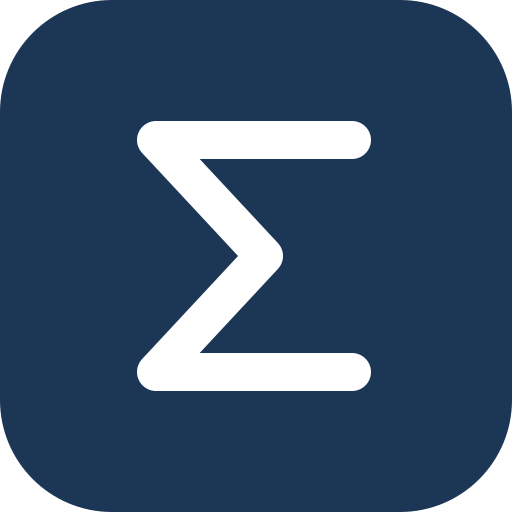

<p align="center">
  
</p>

<h1 align="center">Sig</h1>

<p align="center"><strong>汇聚你的所有 agent。</strong></p>

<p align="center"><a href="README.md">English</a> · 简体中文</p>

Sig 是一个可自行部署的 **Personal Agent（个人智能体）**，基于 **pi-durable** 和 **Cloudflare Durable Objects** 构建。它运行在你自己的 Cloudflare 账号里，记住对话和进行中的任务，并连接你各台电脑上的 coding agent。

名字取自求和符号 **Sigma（Σ）**：通过一个 personal agent，把各台机器上的 agent 汇聚在一起。

打开网页工作台，就能和 Sig 对话：让它处理某个仓库的任务、追问进度，或者接着上次的工作继续做。Sig 负责协调，每台电脑上的轻量 **connector（连接器）** 负责运行本地 agent，再把进展和结果带回来。

- **多台机器，一处对话。** 在同一个地方跟进任务、继续讨论、处理需要你决定的事情。
- **用你自己的电脑和 agent。** 支持 pi，以及已安装的 Claude Code；由你选择开放哪些仓库。
- **上下文持续保留。** 对话和任务状态保存在 Durable Object 中；coding agent 的完整会话记录留在本机，机器在线时可以查看。

## 开始使用

先把 Sig 部署到你的 Cloudflare 账号，再连接实际执行任务的电脑。你需要准备：Cloudflare 账号和供 Sig 使用的模型 API key；**Node.js 22.18+** 只有下面的 agent 路径和 connector 需要。Connector 支持 **macOS 和 Linux**，本地 coding agent 也需要安装并完成它自己的登录或模型配置。

### 1. 部署你的 Personal Agent

**一键部署。** 点击按钮，Cloudflare 会把这个仓库克隆到你的账号并完成构建部署：

开始前，请用密码管理器生成并保存一个**至少 15 个字符**的独立密码，填写到 `LOGIN_PASSWORD`。即使 Cloudflare 表单接受了短密码、常见密码或已泄露密码，Sig 启动后也会拒绝使用它们登录。

[](https://deploy.workers.cloudflare.com/?url=https://github.com/iefnaf/sig)

给 Worker 起个名字，在表单里设置登录密码。构建完成后打开 Worker 地址登录，向导会引导你填写模型 API key。

如果部署时提示 GitHub 授权过期，请按[部署排错指南](docs/deploy.md#deployment-troubleshooting)恢复连接。修改登录密码无法修复 GitHub 授权。

**或交给你的 coding agent。** 复制这段，发给你的 coding agent：

```text
帮我把 Sig 这个 personal agent 部署到我自己的 Cloudflare 账号。

项目仓库：https://github.com/iefnaf/sig
请先阅读仓库里的 docs/agent-deploy.md，并按其中的步骤操作。

检查前置条件，部署 Worker 和 Durable Object，配置密钥，验证访问，
然后打开网页工作台。需要 Cloudflare 授权时引导我完成；模型 API key
由我直接在工作台的设置页填写，不要让密钥出现在聊天或日志里。
最后确认 Sig 能回复一条消息，并告诉我部署地址。
连接电脑这一步，我会另用 connector 安装 prompt 完成。
```

**完成标志：** 能打开网页工作台，Sig 能回复你的第一条消息。还没连接电脑时，也可以先和 Sig 对话。

### 2. 连接你的电脑

在**你希望 Sig 执行任务的那台电脑上**打开 coding agent，复制这段：

```text
帮我在这台电脑上安装 Sig connector，连接到我已经部署在 Cloudflare
上的 personal agent。

项目仓库：https://github.com/iefnaf/sig
请先阅读仓库里的 docs/agent-connect.md，并按其中的步骤操作。

向我确认 Sig 部署地址，以及我要连接的本地仓库。检查 Node.js 和本地
coding agent 的配置，安装 connector，并引导我从网页工作台的「机器」
页面完成配对。启动 connector，只登记我选定的仓库，验证这台机器和
仓库在 Sig 中显示在线。不要让长期凭证出现在聊天或日志里。
最后运行一个小的只读任务，确认整条连接正常工作。
```

**完成标志：** Sig 中能看到机器在线，并且一个只读任务成功返回结果。要连接更多电脑，在每台电脑上重复这段 prompt 即可。

Connector 会主动连接 Sig，你无需给电脑开放入站端口。本地 agent 工作期间，电脑需要保持唤醒和联网。

> 如果你的 agent 无法读取仓库，需要先授予 GitHub 访问权限，或提供本地 checkout。npm 包暂不可用时，connector 指南提供从源码安装的路径。如果所在网络无法访问 `workers.dev`，部署指南也包含自定义域名的配置方法。

## 开始对话

连接电脑后，可以试试：

> 「检查一下 my-app 的登录流程，告诉我发现了什么问题。」
>
> 「用我 Mac 上的 pi 把这个 bug 修一下。」
>
> 「接着上次的任务做，这次用 pnpm。」

工作台把消息、任务线程、待决事项、已连接的机器和会话记录放在一起，界面支持中英文切换。

## 它如何工作

**你 → Cloudflare 上的 Sig → 电脑上的 connector → pi / Claude Code**

云端 agent 使用 **`@earendil-works/pi-durable`** 运行，借助 **Cloudflare Durable Object** 持久化状态并协调任务。Connector 通过 WebSocket 保持连接，在本地启动 coding agent 会话，再把进度回传给 Sig。代码和完整会话文件留在本机；本地 coding agent 仍会照常使用它配置的模型服务。

## 进一步了解

- [部署操作文档](docs/agent-deploy.md) · [Connector 操作文档](docs/agent-connect.md)：供你的 coding agent 执行。
- [部署指南](docs/deploy.md)：手动部署、模型配置、自定义域名、费用和更新。
- [使用说明与 API](docs/usage.md)：Owner API、本地 agent 行为和会话查看。
- [架构设计](docs/design/steward.md) · [产品规格](docs/spec.md) · [路由评测](docs/routing-eval.md)：面向贡献者。

## 许可证

Sig 采用 [MIT License](LICENSE)。
